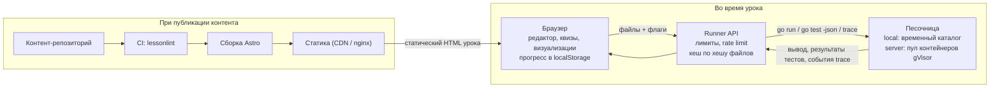
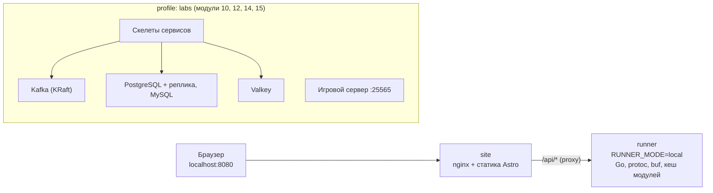
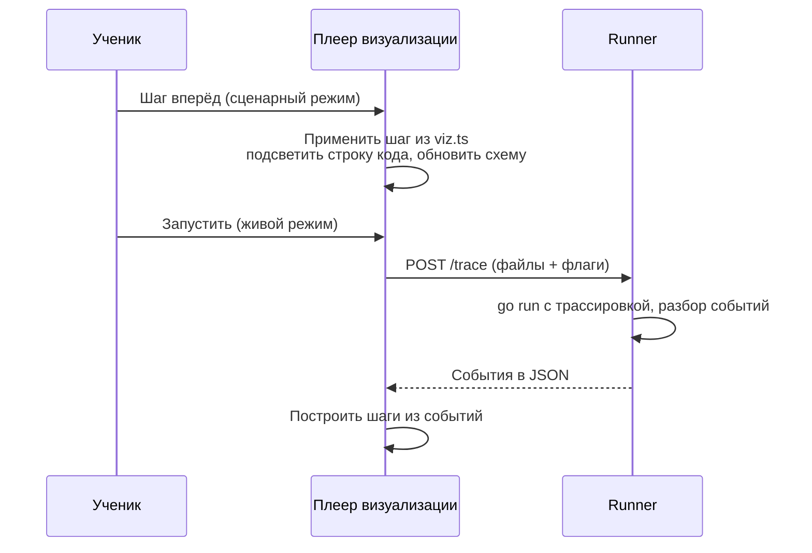

# Go для C#-разработчика — план интерактивного учебника

> Версия плана: 2026-11-08 — в модуль 14 добавлен блок «Данные в памяти и lock-free» (~7 уроков), в модуле 10 — 15 уроков. Ранее, 2026-11-07: закрыты все открытые вопросы (только локальный запуск, код выполняется только в настоящем Go, шаги развития прогресса, предметная область, свои примеры); добавлен модуль 15 «Кейс: игровой сервер» и этап 13; приняты решения по БД (PostgreSQL + MySQL), кешу (Valkey), брокеру (Kafka) и `govulncheck`; добавлены модули 9 «Безопасность», 10 «Сервисы и базы данных» и 14 «Высокие нагрузки» с этапами 8, 9 и 12; модули gRPC, микросервисов и рантайма стали 11–13. Документ предназначен для AI-агента, который будет реализовывать учебник, и для людей, которые его ревьюят.

## Инструкции для агента

- **Цель:** построить интерактивный учебник по Go для разработчиков с опытом C#: статический сайт с уроками, песочницей для запуска кода, квизами, задачами с автотестами и пошаговыми визуализациями механизмов Go.
- **Порядок работы:** строго по разделу «Этапы реализации». Не начинать следующий этап, пока не выполнены критерии готовности текущего.
- **Источник истины для контента:** раздел «Программа курса» и формат папки урока из раздела «Стек и структура репозитория».
- **Пилоты прежде масштаба:** формат урока, визуализатора и задачи фиксируется на пилотных уроках (Slices, Select) и только потом тиражируется.
- **Каждый урок должен проходить CI** (`lessonlint`): пример компилируется и даёт ожидаемый вывод, эталон проходит тесты, шаблон задачи компилируется и не проходит тесты, ответы квизов «что выведет» сверяются с реальным запуском.
- **Открытые вопросы** (последний раздел) не решать самостоятельно: если этап упирается в один из них — остановиться и спросить.
- **Язык:** тексты уроков на русском; идентификаторы, имена файлов и коммиты — на английском.

## Цели и принципы

Учебник ведёт C#-разработчика от синтаксиса Go до продакшн-микросервисов на gRPC за 15 модулей и ~195 уроков; каждый урок запускается и проверяется прямо в браузере.

**Аудитория:** разработчик с опытом C#/.NET (async/await, LINQ, DI, ASP.NET Core, исключения, наследование). Основы программирования не объясняем — объясняем, чем Go отличается и почему.

**Принципы подачи:**

- **«Мост из C#».** В каждом уроке блок «Как это в C#» с парным кодом: `Task` → горутина + канал, `try/catch` → `error` + `errors.Is/As`, `IDisposable`/`using` → `defer`, интерфейсы с явной реализацией → неявные (structural typing), `List<T>` → срез и его ловушки.
- **Безопасно по умолчанию.** Примеры и эталоны не показывают небезопасных практик без явной пометки: SQL только с плейсхолдерами, `html/template` для HTML, `crypto/rand` для токенов, таймауты у серверов и клиентов, проверка TLS. Уязвимый код — только в ловушках и уроках модуля «Безопасность», и он подписан как уязвимый.
- **«Ловушки для C#-ника».** Отдельная плашка с типичной ошибкой переноса привычек: nil-интерфейс с nil-указателем внутри, захват переменной цикла, append в общий backing array, value vs pointer receiver.
- **Минимум теории до кода.** Как на [gobyexample.com](https://gobyexample.com/): короткий аннотированный пример → запуск → задание.
- **Каждый урок проверяемый:** квиз на понимание + задача с автотестами.
- **Версия языка:** ориентир — актуальный стабильный Go (generics, range-over-func итераторы, `log/slog`, новый `net/http` роутинг с методами и шаблонами путей).

## Анатомия урока

Каждая страница урока собирается из одних и тех же блоков, чтобы контент писался по шаблону, а движок рендерил их единообразно.

1. **Шапка:** модуль, номер, сложность (1–5), время (~10–20 мин), пререквизиты, прогресс.
2. **Аннотированный пример** в стиле gobyexample: две колонки — пояснение слева, код справа, построчная привязка.
3. **«Как это в C#»:** сворачиваемый блок, код C# рядом с Go, 2–4 пункта различий.
4. **Песочница:** редактор с кодом примера, кнопки «Запустить», «Сбросить», «Поделиться», вывод stdout/stderr, время выполнения.
5. **«Под капотом»** (для уроков с механизмами): пошаговый визуализатор (см. «Визуализации механизмов»), ссылки на исходники Go.
6. **Ловушки:** 1–3 короткие плашки с неочевидным поведением и коротким воспроизводящим примером.
7. **Квиз:** 3–5 вопросов («что выведет код», «скомпилируется ли», выбор правильного варианта).
8. **Практическое задание:** условие, шаблон кода, скрытые и открытые тесты, подсказки по уровням, эталонное решение (открывается после успеха или 3 попыток).
9. **Навигация:** назад/вперёд, отметка «пройдено», ссылки на документацию (go.dev, pkg.go.dev, spec).

## Архитектура и песочница

Решение: статический фронтенд + собственный сервис исполнения (runner) в изолированных контейнерах; публичный Go Playground не подходит как основа, потому что не даёт запускать тесты с нашей разметкой, многофайловые проекты с `.proto` и контролировать лимиты.



Сайт полностью статический; сервер нужен только runner, который получает файлы урока и возвращает вывод или результаты тестов обратно в браузер.

| Вариант | Плюсы | Минусы | Роль |
| --- | --- | --- | --- |
| Свой runner (Docker + gVisor/nsjail) | Настоящий `go build`/`go test`, `-race`, многофайловые проекты, предустановленные grpc/protobuf, свои лимиты | Нужен сервер и защита от злоупотреблений | **Основной** |
| Публичный Go Playground | Ноль инфраструктуры | Нет контроля, нет нашего тест-харнесса, ограничения по запросам из браузера | Только кнопка «Открыть в go.dev/play» |
| Go в браузере (Yaegi или компилятор gc в WebAssembly) | Работает без Docker | Отличается от настоящей среды: в браузере один поток (иначе ведут себя горутины), нет `-race`, сети, процессов и сигналов, а Yaegi вдобавок не поддерживает весь язык | Не используем: учебник и так запускается локально в Docker с настоящим Go |
| Предвычисленный вывод | Работает везде | Код нельзя менять | Фолбэк, если локальный runner не запущен: песочница показывает проверенный `output.txt` и подсказывает, как запустить Docker |

**Требования к runner:**

- API: `POST /run` (go run), `POST /test` (go test -json), `POST /fmt`, `POST /vet`, `POST /trace` (для живых визуализаций); вход — набор файлов (`main.go`, `*_test.go`, `go.mod`, `*.proto`).
- Лимиты: 10 с CPU, 256 МБ памяти, вывод до 64 КБ, без внешней сети (только loopback — нужен для HTTP/gRPC-уроков).
- Образ с прогретым кешем модулей (`google.golang.org/grpc`, `protobuf`, зависимости уроков) и `protoc` + `protoc-gen-go` + `protoc-gen-go-grpc` (или `buf`) для генерации кода из контрактов.
- Флаги на урок: `-race`, `GODEBUG`, `GOMAXPROCS`, `-gcflags=-m` (escape analysis), `GOTRACEBACK`.
- Для `govulncheck`: снимок базы уязвимостей Go (vuln.go.dev) в образе runner, обновляется при каждой пересборке образа; урок называет дату снимка.
- Для модуля «Безопасность»: SQLite на чистом Go (`modernc.org/sqlite`) для уроков об инъекциях, `golang.org/x/crypto` (bcrypt, argon2id), HTTP на loopback для демонстраций SSRF и CSRF; эксплойты работают только внутри песочницы.
- Пул «тёплых» контейнеров для ответа за ~1–2 с, rate limit по IP, кеш результатов по хешу файлов.

**Микросервисы в песочнице:** несколько сервисов запускаются в одном процессе как горутины на loopback-портах или через `bufconn`; для лаб с несколькими бинарниками, БД и брокером — отдельный профиль Docker Compose (см. ниже).

### Локальный запуск — Docker Compose

Весь учебник поднимается одной командой `docker compose up` и открывается на `localhost:8080`; кроме Docker, ничего ставить не нужно. Решено: учебник работает только локально, общего сервера нет. Режим `server` остаётся в коде runner на будущее (см. «Шаги развития»).

- Сервис `site` — nginx со статической сборкой Astro; сервис `runner` — тот же образ исполнения, что и на сервере: зафиксированная версия Go, `protoc`, `protoc-gen-go`, `protoc-gen-go-grpc`, `buf`, прогретый кеш модулей (`grpc`, `protobuf` и др.).
- Runner один на все окружения, режим задаётся переменной: `RUNNER_MODE=local` — каждый запуск в отдельном временном каталоге внутри контейнера с таймаутом и лимитом вывода, без gVisor; `RUNNER_MODE=server` — пул изолированных контейнеров с gVisor для публичного развёртывания.
- Работает офлайн после первой загрузки образов; одинаково на Windows, macOS и Linux (через Docker Desktop).
- Прогресс хранится в `localStorage` браузера, экспорт/импорт JSON — для переноса между машинами.
- Лабы модулей 10, 12, 14 и 15 подключаются как отдельный профиль: `docker compose --profile labs up` добавляет PostgreSQL (основной и реплику), MySQL, Valkey, Kafka (режим KRaft, без ZooKeeper), скелеты сервисов и игровой сервер на `localhost:25565`, к которому подключается свой клиент Minecraft.
- Обновление учебника: `git pull` + `docker compose pull`; образы публикуются в реестр с тегом версии курса.



## Программа курса

Курс состоит из 15 модулей и ~195 уроков: модули 1–6 повторяют и расширяют порядок [gobyexample.com](https://gobyexample.com/), модули 7–14 добавляют то, чего там нет — тестирование, веб, безопасность, практики разработки сервисов и работу с БД, контракты и gRPC, микросервисы, внутренности рантайма и высокие нагрузки, а модуль 15 — сквозной кейс: игровой сервер.

| № | Модуль | Темы | Акцент для C#-разработчика | Уроков |
| --- | --- | --- | --- | --- |
| 1 | Старт и инструменты | Hello World, values, variables, constants, `go mod`, пакеты, `go run/build/vet`, gofmt, структура проекта | Нет классов и namespace; видимость по регистру первой буквы; один стиль форматирования | 6 |
| 2 | Базовый синтаксис | for (единственный цикл), if/else с init, switch, arrays, slices (len/cap, append, общий backing array), maps, range, strings и runes, pointers, функции, multiple returns, variadic, closures, recursion | `string` — байты UTF-8, а не UTF-16; срез — не `List<T>`; указатели без арифметики; zero values вместо null | 16 |
| 3 | Типы и абстракции | structs, methods (value vs pointer receiver), interfaces, enums через `iota`, struct embedding, generics и constraints, range over iterators (`iter.Seq`) | Неявная реализация интерфейсов; композиция вместо наследования; generics слабее C# (нет методов-дженериков); итераторы vs `IEnumerable`/`yield` | 10 |
| 4 | Ошибки | errors, custom errors, wrapping `%w`, `errors.Is/As/Join`, sentinel errors, panic, defer, recover | Ошибка — значение, не исключение; `defer` вместо `using/finally`; nil-интерфейс с nil-указателем | 6 |
| 5 | Конкурентность | goroutines, channels (буфер, синхронизация, направления), select, timeouts, non-blocking ops, closing, range over channels, timers, tickers, worker pools, WaitGroup, rate limiting, atomics, mutexes, stateful goroutines, `sync.Once`, `errgroup`, context, pipeline / fan-in / fan-out, утечки горутин, `-race` | Нет async/await: синхронный код + горутины; `context` вместо `CancellationToken`; «share memory by communicating» | 22 |
| 6 | Стандартная библиотека | sorting (`slices`, `cmp`), строки и форматирование, text templates, regexp, JSON и XML (теги), time и epoch, парсинг чисел и URL, SHA256, base64, файлы, пути, директории, temp files, `embed`, CLI args / flags / subcommands, env, `log/slog`, процессы, сигналы, exit | Stdlib вместо NuGet по умолчанию; struct tags вместо атрибутов; нет LINQ — циклы и `slices`/`maps` | 22 |
| 7 | Тестирование и качество | `testing`, table-driven tests, subtests, `t.Parallel`, benchmarks, fuzzing, examples, `httptest`, моки через интерфейсы, coverage, golangci-lint; практики тестов в промышленном проекте (детерминизм, изоляция, фейки, интеграционные тесты, CI) | Тесты рядом с кодом в `_test.go`; без фреймворков и DI-контейнера | 9 |
| 8 | Сеть и веб | HTTP client (таймауты), HTTP server, `ServeMux` с методами и шаблонами путей, middleware, graceful shutdown, TCP server, REST + JSON, валидация, `database/sql` | Нет ASP.NET-конвейера: `http.Handler` и обёртки; сервер — обычная функция `main` | 10 |
| 9 | Безопасность | Модель угроз, OWASP Top 10 (актуальная редакция) и OWASP API Security Top 10 для сервисов; границы доверия и валидация ввода (лимиты размера, строгий JSON, переполнения); SQL-инъекции (`database/sql` с плейсхолдерами, allowlist для идентификаторов и `ORDER BY`); командные инъекции и path traversal (`exec` без shell, `filepath.IsLocal`, `os.Root`, zip slip); XSS и контекстное экранирование (`html/template` vs `text/template`, ловушки `template.HTML`/`JS`/`URL`, JSON внутри `<script>`, `Content-Type`, CSP); CSRF, CORS и заголовки (`http.CrossOriginProtection`, SameSite-cookie, ошибки CORS); пароли, сессии и токены (bcrypt/argon2id, `crypto/rand`, `subtle.ConstantTimeCompare`, ловушки JWT); криптография без самодеятельности (AES-GCM и повтор nonce, HMAC, настройки TLS, `InsecureSkipVerify`); SSRF и исходящие запросы (приватные адреса, DNS rebinding, `Dialer.Control`, редиректы); DoS и лимиты (таймауты сервера и Slowloris, `MaxBytesReader`, decompression bomb, ReDoS vs RE2, лимит горутин); секреты, логи и ошибки наружу (редакция в `slog`, ответ без деталей, паника → 500 без стека); зависимости и цепочка поставок (`go.sum`, `GOSUMDB`, `govulncheck`); итоговое ревью «найди и почини» | Классы уязвимостей те же, что в ASP.NET, но защиты конвейера «из коробки» нет: антифорджери-токены, автоэкранирование Razor и `[Authorize]` заменяют `CrossOriginProtection`, `html/template` и явные проверки в middleware | 12 |
| 10 | Сервисы и базы данных: практики | Идиоматичный Go в продакшне: Effective Go, Go Code Review Comments, частые замечания ревью; раскладка проекта (`cmd/`, `internal/`, пакеты по смыслу, а не по слоям), интерфейсы на стороне потребителя, ручная сборка зависимостей в `main`, конфигурация, ошибки и `context` через все слои, graceful shutdown, тестируемость (фейки вместо моков, тесты с БД); работа с БД в целом: `database/sql`, пул соединений (`SetMaxOpenConns`, `SetConnMaxLifetime`, утечка соединения из-за незакрытых `Rows`), таймауты через `context`, транзакции, оптимистичные и пессимистичные блокировки (`SELECT … FOR UPDATE`, версия строки), `NULL` и `sql.Null*`, миграции (goose / golang-migrate), `sqlc` как основной способ (GORM и query builder — для сравнения), N+1, батчи, повторы при конфликтах, transactional outbox; **PostgreSQL** (основная БД курса): `pgx` и `pgxpool` напрямую, плейсхолдеры `$1`, `RETURNING`, `ON CONFLICT`, `COPY`, `JSONB`, массивы, `LISTEN/NOTIFY`, advisory locks; MVCC и `VACUUM`, уровни изоляции (Read Committed по умолчанию, Repeatable Read как снимок, Serializable на SSI и ошибка `40001` с повтором), индексы (B-tree, GIN, BRIN, частичные, покрывающие), `EXPLAIN ANALYZE`, кеш подготовленных запросов `pgx` и PgBouncer в режиме transaction; **MySQL** (отличия на практике): `go-sql-driver/mysql` через `database/sql`, плейсхолдеры `?`, `parseTime=true` и часовые пояса, `utf8mb4`, `LastInsertId` вместо `RETURNING`, `ON DUPLICATE KEY UPDATE` вместо `ON CONFLICT`, Repeatable Read по умолчанию в InnoDB и gap locks, дедлоки и их повтор | Нет EF Core и `DbContext` с change tracking: SQL пишется явно или генерируется (`sqlc`); пул соединений встроен в `*sql.DB` / `pgxpool`, а не в провайдер; нет `TransactionScope` — транзакция передаётся явно; Npgsql и MySqlConnector ↔ `pgx` и `go-sql-driver/mysql` | 15 |
| 11 | Контракты и gRPC | proto3, правила эволюции контракта (номера полей, `reserved`, обратная совместимость), генерация кода (protoc/buf), unary и streaming RPC (server, client, bidi), metadata, deadlines, status codes и error details, interceptors, health checking, reflection, `buf lint` / `buf breaking`, REST из proto (grpc-gateway или Connect) | Сравнение с Grpc.AspNetCore; контракт как источник истины для нескольких языков | 12 |
| 12 | Микросервисы | Сервис из модуля 10 как основа; observability (slog, OpenTelemetry, Prometheus), resilience (retries, backoff, circuit breaker, проброс дедлайнов), сообщения в Kafka на `franz-go` (топики и партиции, ключ и порядок сообщений, consumer groups и ребалансировка, коммит офсетов и at-least-once, идемпотентный продюсер, повторы и DLQ, публикация через outbox из модуля 10), идемпотентность, Docker multi-stage, k8s probes; **итоговый проект** из 3 сервисов | Нет Microsoft.Extensions.*: явная композиция в `main`; маленькие бинарники и быстрый старт | 12 |
| 13 | Механизмы рантайма | Планировщик GMP, стеки горутин, escape analysis (`-gcflags=-m`), GC (tri-color, `GOGC`, `GOMEMLIMIT`), устройство slice / map / string / interface (iface, eface, itab), каналы внутри (hchan), memory model и happens-before, `sync.Pool`, reflection и `unsafe`, pprof и `go tool trace`, inlining, BCE, PGO | Сравнение с CLR: GC без поколений и компактификации, value types по умолчанию, нет JIT | 12 |
| 14 | Высокие нагрузки и масштабирование | Как измерять: нагрузочное тестирование (открытая и закрытая модели нагрузки, перцентили, coordinated omission), профилирование под нагрузкой (pprof, trace); сервис без лишних аллокаций (`sync.Pool`, переиспользование буферов, `GOGC`/`GOMEMLIMIT` для задержек); настройка `http.Transport` и keep-alive; backpressure, load shedding, ограничение параллелизма и очередей; кеширование: in-process (LRU, TTL, шардированный кеш), распределённый (Valkey — открытый форк Redis, клиент `valkey-go`), стратегии cache-aside / write-through / write-behind, инвалидация, cache stampede и `singleflight`, отрицательное кеширование, прогрев; БД под нагрузкой: индексы и планы запросов, пул соединений и PgBouncer, реплики для чтения и задержка репликации (PostgreSQL streaming replication, MySQL binlog), партиционирование таблиц PostgreSQL, шардирование на уровне приложения (ключ шарда, хеш- и диапазонное, consistent hashing и rendezvous, решардинг, кросс-шардовые запросы) и готовые решения — Citus для PostgreSQL, Vitess для MySQL — обзорно, асинхронная обработка через очереди, идемпотентность и дедупликация, CQRS — когда оправдан; stateless-сервисы и горизонтальное масштабирование; **данные в памяти**: иерархия кешей процессора и кеш-линии, локальность данных (срез против связного списка, обход по строкам и столбцам), раскладка структур (выравнивание и padding, `unsafe.Sizeof`/`Alignof`, порядок полей, срез структур против среза указателей, AoS против SoA, разделение горячих и холодных полей), структуры без указателей и нагрузка на GC (индексы вместо указателей, `[]byte`-арены и смещения для больших кешей, интернирование строк пакетом `unique`), выбор структуры под нагрузку (map на Swiss tables: предразмер, рост, удаление не возвращает память; отсортированный срез и бинарный поиск, кольцевой буфер, bitset, `container/heap`, фильтр Блума); **lock-free**: false sharing и выравнивание до кеш-линии, шардированные счётчики и striped locks, когда `RWMutex` хуже `Mutex`; атомики и memory model глубже (CAS-циклы, `atomic.Pointer`, последовательная согласованность `sync/atomic`), copy-on-write конфигурация через `atomic.Pointer` (идея RCU), стек Трайбера, ABA и почему GC Go его смягчает, очередь Майкла — Скотта обзорно, SPSC/MPSC кольцевой буфер на атомиках, `sync.Map` — когда подходит; когда lock-free не нужен и как проверять (`-race`, стресс-тесты, бенчмарки с `-cpu`, `benchstat`) | Те же паттерны, что в .NET (`IMemoryCache`, `IDistributedCache` поверх Redis/Valkey, Polly), но меньше готовых абстракций: кеш и ограничители пишутся или берутся маленькими библиотеками; GC без поколений — другая настройка под задержки; горутины вместо пула потоков; `StructLayout` и `Interlocked`/`Volatile` ↔ порядок полей и `sync/atomic`, `ConcurrentDictionary` ↔ `sync.Map` и шардированная map | 19 |
| 15 | Кейс: игровой сервер | Базовый сервер, совместимый с протоколом Minecraft Java Edition, и практики, которые на нём видны лучше всего. Протокол: TCP и кадрирование (длина в VarInt), `encoding/binary`, состояния соединения (handshake → status → login → play), ответ на пинг списка серверов, вход в offline-режиме, keep-alive, чат, плоский мир из чанков; сжатие пакетов — обзорно, шифрование online-режима — только обзорно. Архитектура: игровой цикл с фиксированным тиком (20 TPS) и одна горутина-владелец состояния мира; на соединение — горутины чтения и записи, связь с миром через ограниченные каналы; медленный клиент — переполнение исходящей очереди и отключение, а не остановка тика; дедлайны чтения и записи. Мир: чанки, дальность видимости и interest management (кому что отправлять), пространственный хеш для поиска сущностей рядом, отправка изменений, а не полного состояния. Производительность: тик без аллокаций (пулы буферов, предвыделение, `GOMEMLIMIT`), измерение длительности тика (MSPT) и TPS, поведение при перегрузке, профилирование тика. Надёжность и безопасность: лимиты на длину пакетов и частоту действий, проверка ввода на сервере (скорость перемещения, дальность взаимодействия), fuzzing декодера пакетов, асинхронное сохранение мира снапшотами без остановки тика, graceful shutdown с сохранением. Тестирование: детерминированная симуляция с фейковыми часами, боты на Go как нагрузочные клиенты. Масштабирование: мир или инстанс как шард, прокси перед несколькими серверами (идея Velocity/BungeeCord), перенос игрока между серверами — обзорно. Разбор открытых серверов на Go (Dragonfly для Bedrock, библиотека `go-mc`) | Похоже на игровые серверы на .NET (MonoGame-серверы, Unity Netcode), но без async/await: синхронный код на горутинах, а владение состоянием мира — у одной горутины вместо `lock`; свой бинарный протокол вместо готового сериализатора; задержки GC без поколений настраиваются иначе, чем Server GC | 12 |

## Тесты и задания

Проверка двух видов: квизы проверяются в браузере без сервера, практические задачи — через `go test -json` в runner со скрытыми тестами.

**Типы вопросов в квизах:**

- «Что выведет программа?» — главный тип: ловит непонимание семантики (срезы, замыкания, defer, порядок в select).
- «Скомпилируется ли?» — неиспользуемые переменные/импорты, типы, видимость.
- Один / несколько правильных ответов, упорядочивание шагов, заполнение пропуска в коде.
- У каждого варианта — объяснение, почему он верен или неверен.

**Практические задачи:**

- Файлы задачи: `task.go` (шаблон для ученика), `task_test.go` (открытые тесты, видны), `hidden_test.go` (скрытые, только на сервере), `solution.go` (эталон).
- Результат `go test -json` разбирается на фронте в список «тест → ok / fail + сообщение».
- Дополнительные проверки по флагам задачи: `go vet`, `-race` для модуля 5, лимит времени, порог бенчмарка для задач на производительность, проверка AST (например, «решите без `sync.Mutex`»).
- Для задач на `main` — сравнение stdout с ожидаемым (с нормализацией порядка, где он не детерминирован).
- Подсказки в 3 уровня; эталон открывается после успеха или 3 неудачных попыток.

**Контрольные точки:** в конце каждого модуля — экзамен (10–15 вопросов) и мини-проект; модули 11–12 завершаются проектом из трёх сервисов «заказы → склад → уведомления»; модуль 9 — ревью уязвимого сервиса; модуль 14 — нагрузочный разбор итогового проекта: найти узкое место, добавить кеш, разнести чтение по репликам.

**Прогресс:** хранится в `localStorage` с экспортом/импортом JSON; аккаунты и синхронизация — после MVP.

## Визуализации механизмов

Каждый механизм, который меняет состояние во времени, получает пошаговый визуализатор: код слева, схема состояния справа, плеер «шаг назад / вперёд / авто» снизу; всего ~28 визуализаторов.

**Два вида:**

- **Сценарные** — заранее описанные шаги с пояснением к каждому; детерминированы, объясняют устройство механизма.
- **Живые** — код ученика запускается в runner, а схема строится из того, что реально произошло: `runtime/trace`, `GODEBUG=schedtrace`, вывод `-gcflags=-m`, отчёт `-race`. Ученик меняет `GOMAXPROCS`, размер буфера или код и видит разницу.



**Список визуализаторов:**

| Визуализатор | Модуль | Вид | Что показывает |
| --- | --- | --- | --- |
| Slice header и `append` | 2 | Сценарный + живой | ptr/len/cap, переаллокация, общий backing array у двух срезов |
| Устройство map | 2, 13 | Сценарный | Swiss tables, группы и контрольные байты, рост таблицы, случайный порядок обхода |
| String, `[]byte`, руны | 2 | Сценарный | Байты UTF-8, индексация по байтам и по рунам, копирование при конвертации |
| Интерфейс изнутри | 3, 13 | Сценарный | iface/eface, itab, почему nil-указатель в интерфейсе ≠ nil |
| Stack или heap | 13 | Живой | Escape analysis по выводу `-gcflags=-m`, какие переменные «убегают» и почему |
| `defer` / `panic` / `recover` | 4 | Сценарный | Стек вызовов, порядок отложенных вызовов, раскрутка и перехват паники |
| Планировщик GMP | 5, 13 | Сценарный + живой | Локальные очереди P, глобальная очередь, work stealing, handoff при syscall, вытеснение |
| Канал изнутри (hchan) | 5, 13 | Сценарный | Кольцевой буфер, очереди sendq/recvq, блокировка и пробуждение горутин, закрытие |
| `select` | 5 | Живой | Готовые ветки, случайный выбор, default, таймауты |
| Дерево `context` | 5 | Сценарный | Распространение отмены и дедлайна от родителя к потомкам |
| Pipeline, fan-in, fan-out | 5 | Живой | Поток значений между стадиями, backpressure при заполнении буфера |
| Утечка горутины | 5 | Живой | Горутина, навсегда заблокированная на канале, рост числа горутин |
| Гонка данных | 5 | Живой | Таймлайн двух горутин, конфликтующие доступы по отчёту `-race` |
| Mutex и WaitGroup | 5 | Сценарный | Захват, ожидание, очередь ждущих горутин, счётчик WaitGroup |
| Сборщик мусора | 13 | Сценарный | Трёхцветная маркировка, write barrier, фазы, влияние `GOGC` и `GOMEMLIMIT` |
| Рост стека горутины | 13 | Сценарный | Стартовый стек, переполнение, копирование в больший стек |
| SQL-инъекция | 9 | Сценарный | Как конкатенация превращает ввод в часть запроса, а плейсхолдер передаёт его отдельно как значение |
| Контекстное экранирование | 9 | Сценарный | Одно и то же значение в тексте HTML, атрибуте, URL и `<script>`: что делает `html/template` в каждом контексте и где `template.HTML` пробивает защиту |
| Пул соединений `database/sql` | 10 | Сценарный + живой | Открытые и простаивающие соединения, очередь ожидания при `MaxOpenConns`, утечка соединения из-за незакрытых `Rows` |
| Транзакции и изоляция | 10 | Сценарный | Две транзакции на одной таблице: грязное и неповторяемое чтение, фантомы, конфликт сериализации и повтор |
| Cache stampede и `singleflight` | 14 | Живой | Сотни горутин за одним ключом: без `singleflight` — сотни запросов к БД, с ним — один |
| Шардирование и consistent hashing | 14 | Сценарный | Кольцо хешей, виртуальные узлы, сколько ключей переезжает при добавлении шарда — против `hash % N` |
| Кеш-линии и false sharing | 14 | Сценарный | Два ядра, их кеши и общая кеш-линия: соседние счётчики гоняют линию между ядрами, после выравнивания до 64 байт — каждый в своей |
| Lock-free стек на CAS | 14 | Сценарный + живой | Две горутины делают `CompareAndSwap` вершины: одна выигрывает, другая перечитывает и повторяет; ABA и почему GC Go его смягчает |
| Игровой цикл и тики | 15 | Живой | Длительность каждого тика по трассе: где тик укладывается в 50 мс, где нет, сколько тиков пропущено, какая работа их съела |
| Чанки и зона видимости | 15 | Сценарный + живой (браузерный клиент) | Игрок двигается по миру: какие чанки загружаются и выгружаются, кому из игроков уходят какие обновления |
| HTTP-запрос в сервере | 8 | Сценарный | Путь через `ServeMux` и цепочку middleware, отмена при обрыве клиента |
| gRPC-вызов | 11 | Сценарный + живой | Interceptors клиента и сервера, metadata, status codes, HTTP/2-потоки |
| Проброс дедлайна | 11, 12 | Живой | Цепочка из 3 сервисов, остаток времени на каждом шаге, отмена по таймауту |
| Resilience | 12, 14 | Сценарный | Состояния circuit breaker, retries с backoff, graceful shutdown |

**Режим слайдов:** обзор каждого модуля на 8–12 экранов с ключевыми визуализациями — для показа команде.

**Как устроено:**

- Сценарий визуализатора — файл `viz.ts` рядом с уроком: список шагов, у каждого — строка кода для подсветки, состояние схемы, пояснение.
- Общий движок на TypeScript + SVG: плеер, переходы между состояниями, синхронизация с редактором, переиспользуемые примитивы (горутина, канал, очередь, ячейка памяти, сервис).
- Для живых визуализаций runner получает эндпоинт `POST /trace`: запускает код с трассировкой и возвращает события в JSON, уже разобранные на сервере.
- Доступность: у каждого шага есть текстовое описание, при `prefers-reduced-motion` анимации заменяются мгновенными переходами.

## Стек и структура репозитория

Контент живёт в репозитории как папки уроков с настоящими `.go`-файлами, а CI прогоняет каждый пример и каждое эталонное решение — так учебник не «протухает» при обновлении Go.

| Слой | Выбор | Почему |
| --- | --- | --- |
| Сайт | Astro (статическая генерация) + TypeScript | Уроки из Markdown, интерактивные «острова» только там, где нужны; итог — статический HTML |
| Редактор кода | CodeMirror 6 | Лёгкий, работает на мобильных; Monaco — альтернатива, если нужен IntelliSense-подобный опыт |
| Подсветка в примерах | Shiki | Подсветка при сборке, без JS в рантайме |
| Поиск | Pagefind | Статический индекс, без сервера |
| Runner | Сервис на Go + Docker с gVisor (`runsc`) в режиме `server` | Изоляция недоверенного кода, настоящий тулчейн Go |
| Визуализации | TypeScript + SVG, D2 | Пошаговые визуализаторы на своём движке; D2 — для статичных схем |
| Локальный запуск | Docker Compose | Одна команда, одинаковая среда на всех ОС |

**Формат урока:**

```
content/
  05-concurrency/
    module.yaml            # название, порядок, цели модуля
    07-select/
      lesson.md            # текст, frontmatter: сложность, время, пререквизиты, флаги runner
      example/main.go      # аннотированный пример (комментарии → левая колонка)
      csharp/Example.cs    # блок «Как это в C#»
      quiz.yaml            # вопросы, варианты, объяснения
      viz.ts               # сценарий визуализатора (если есть)
      task/
        task.go            # шаблон ученика
        task_test.go       # открытые тесты
        hidden_test.go     # скрытые тесты
        solution.go        # эталон
        hints.md
runner/                    # сервис исполнения
site/                      # Astro
viz/                       # движок визуализаций
tools/lessonlint/          # проверка структуры и прогон всех уроков в CI
docker-compose.yml         # site + runner, profile labs
```

**CI-проверки контента:** пример компилируется и даёт ожидаемый вывод; `solution.go` проходит все тесты; шаблон `task.go` компилируется и **не** проходит тесты; квизы «что выведет» сверяются с реальным запуском.

## Этапы реализации

Сначала делаем платформу на двух пилотных уроках, затем наполняем контент модулями — так формат урока фиксируется до того, как написано 130 страниц.

```mermaid
flowchart LR
    E1["1. Каркас"] --> E2["2. Runner MVP"] --> E3["3. Интерактив"] --> E4["4. Движок визуализаций"]
    E4 --> E5["5. Модули 1–4"] --> E6["6. Модули 5–6"] --> E7["7. Модули 7–8"] --> E8["8. Безопасность"] --> E9["9. Сервисы и БД"] --> E10["10. Модули 11–12"] --> E11["11. Модуль 13"] --> E12["12. Высокие нагрузки"] --> E13["13. Игровой сервер"] --> E14["14. Полировка и запуск"]
```



1. **Каркас.** Репозиторий, формат папки урока, `lessonlint`, шаблон страницы на Astro, 2 пилотных урока (Slices, Select).
    - Готово, когда: урок собирается из папки, CI проверяет пример и эталон.
2. **Runner MVP.** `/run`, `/test`, `/fmt` в Docker + gVisor, лимиты, пул тёплых контейнеров, `docker-compose.yml` с сервисами `site` и `runner`, режимы `RUNNER_MODE=local|server`.
    - Готово, когда: пример выполняется за ≤ 2 с, вывод `go test -json` разобран, бесконечный цикл и fork-бомба корректно обрываются, `docker compose up` поднимает рабочий учебник локально.
3. **Интерактив.** Редактор, песочница, квизы, задачи с открытыми/скрытыми тестами, подсказки, прогресс.
    - Готово, когда: оба пилотных урока проходятся от начала до конца.
4. **Движок визуализаций.** Плеер шагов, примитивы SVG, синхронизация с подсветкой кода, формат `viz.ts`, эндпоинт `/trace` в runner, режим слайдов; пилоты — slice header (сценарный) и `select` (живой).
    - Готово, когда: оба пилотных визуализатора работают в уроках, шаги листаются в обе стороны, живой режим строит схему по реальному запуску.
5. **Контент: модули 1–4** (~38 уроков) с блоками C#, ловушками и визуализаторами данных (map, строки, интерфейсы, defer/panic).
6. **Контент: модули 5–6** (~44 урока); в runner включён `-race`; визуализаторы конкурентности (GMP, hchan, context, pipeline, утечки, гонки, mutex).
7. **Контент: модули 7–8** (~18 уроков); `httptest`, бенчмарки, fuzzing в runner; визуализатор HTTP-запроса.
8. **Контент: модуль 9 «Безопасность»** (~12 уроков); в runner — SQLite на чистом Go, `golang.org/x/crypto`, снимок базы уязвимостей для `govulncheck`, HTTP на loopback; визуализаторы SQL-инъекции и контекстного экранирования. Задачи двух видов: «напиши безопасно» и «найди и почини» — шаблон содержит уязвимый код, скрытые тесты — эксплойты (инъекция, XSS-нагрузка, path traversal, SSRF на loopback, перебор по времени), а функциональные тесты при этом проходят. Отдельная вычитка всех примеров курса на небезопасные практики (принцип «безопасно по умолчанию»); найденное исправляется в модулях 1–8.
    - Готово, когда: каждый эксплойт из скрытых тестов срабатывает на шаблоне и не срабатывает на эталоне; итоговое ревью решено «чистым» решателем; в примерах курса нет непомеченных небезопасных практик.
9. **Контент: модуль 10 «Сервисы и базы данных»** (~14 уроков: практики Go-сервисов, общая работа с БД, PostgreSQL подробно, отличия MySQL); в песочнице — SQLite на чистом Go, в профиле `labs` — PostgreSQL и MySQL; в образе runner — `pgx`, `go-sql-driver/mysql`, драйвер SQLite, `sqlc`, миграции; визуализаторы пула соединений и транзакций. Сквозной учебный сервис «Заказы»: заказы, позиции, статусы, резервирование товара на складе в транзакции. Дальше он растёт в модулях 11, 12 и 14. Чек-лист ревью Go-кода (идиомы, ошибки, `context`, ресурсы, БД) — отдельная страница, на неё ссылаются задачи «приведи к виду для ревью».
    - Готово, когда: учебный сервис собирается и проходит тесты против SQLite, PostgreSQL и MySQL; уроки по изоляции и блокировкам воспроизводят аномалии на настоящих PostgreSQL и MySQL в `labs`; задачи на транзакции и пул проверяют поведение под конкурентной нагрузкой без флаков.
10. **Контент: модули 11–12** (~24 урока); `protoc`/`buf` и `franz-go` в образе runner, профиль `labs` с Kafka в Docker Compose (в песочнице брокера нет — там продюсер и консьюмер работают через интерфейсы с фейком в памяти), итоговый проект на основе сервиса из модуля 10: «Заказы» (gRPC и REST, PostgreSQL), «Склад» (резервы с блокировками, MySQL — для практики второй БД), «Уведомления» (консьюмер Kafka); событие «заказ создан» уходит через outbox, отмена резерва — компенсирующим действием (saga); визуализаторы gRPC, дедлайнов и resilience; безопасность сервисов — TLS/mTLS, аутентификация в interceptors и middleware, секреты в конфигурации — со ссылками на модуль 9.
11. **Контент: модуль 13** (~12 уроков) с флагами `GODEBUG`, `-gcflags=-m`, pprof; визуализаторы GC, escape analysis, роста стека.
12. **Контент: модуль 14 «Высокие нагрузки и масштабирование»** (~19 уроков: ~12 о сервисах под нагрузкой и ~7 о данных в памяти и lock-free); в профиле `labs` — реплика PostgreSQL, несколько шардов, Valkey; генератор нагрузки на Go для уроков (в песочнице — короткие прогоны на loopback, полные — в `labs`); визуализаторы cache stampede, consistent hashing, кеш-линий и false sharing, lock-free стека на CAS. Задачи на итоговом проекте: кеш каталога с TTL и защитой от stampede, ограничитель с load shedding на создании заказов, роутер запросов «Заказов» по шардам (ключ — покупатель), перенос чтения истории заказов на реплики с учётом задержки репликации. Задачи блока о памяти и lock-free: перестроить структуру под меньший размер и без указателей (проверка через `unsafe.Sizeof` и `testing.AllocsPerRun`, а не временем), шардированный счётчик с выравниванием до кеш-линии, copy-on-write конфигурация на `atomic.Pointer`, стек Трайбера и SPSC-кольцо на атомиках со стресс-тестами под `-race`. Скорость в тестах не проверяется: разница показывается бенчмарками в примерах (`-benchmem`, `-cpu 1,4`), а их числа зависят от машины, поэтому текст урока не опирается на точные значения.
    - Готово, когда: задачи проверяют поведение под нагрузкой (число обращений к БД, доля отброшенных запросов, распределение ключей) детерминированными тестами, без порогов по времени; нагрузочный разбор итогового проекта воспроизводится одной командой в `labs`.
13. **Контент: модуль 15 «Кейс: игровой сервер»** (~12 уроков). В песочнице — свой упрощённый протокол поверх TCP на loopback и боты-клиенты в тестах. Свой браузерный клиент: вид мира сверху (2D: чанки, блоки, игроки), перемещение и чат; подключается к серверу через WebSocket-шлюз на том же игровом цикле, работает без лицензии Minecraft и служит живым визуализатором мира — на нём видны тики, зона видимости и рассылка обновлений; в профиле `labs` — тот же сервер с подмножеством протокола Minecraft Java Edition: пинг списка серверов, вход в offline-режиме, плоский мир, чат, перемещение игроков. Версия — та, что поддерживает открытая реализация `go-mc`: Minecraft 1.21 / 1.21.1 (протокол 767), `go-mc` из master, зафиксированный псевдоверсией; объём — базовый протокол: handshake, пинг списка серверов, вход в offline-режиме, фаза configuration с реестрами, keep-alive, плоский мир, перемещение, чат. Кадрирование и состояния соединения пишем сами, `go-mc` берём для данных, которые нет смысла писать руками (реестры, NBT, форматы чанков). Ресурсы Mojang не распространяются: игрок подключается своим лицензионным клиентом, сервер не называет себя официальным. Визуализаторы игрового цикла и зоны видимости. Задачи: декодер пакетов с лимитами (и fuzz-тест), исходящая очередь с отключением медленного клиента, тик без аллокаций (проверка через `testing.AllocsPerRun`), interest management по чанкам, валидация перемещений, снапшот мира без остановки тика.
    - Готово, когда: свой клиент Minecraft и браузерный клиент одновременно подключаются к серверу из `labs` и видят мир и друг друга; нагрузочный прогон ботами держит 20 TPS на заданном числе игроков; задачи проверяются в песочнице без клиента Minecraft.
14. **Полировка и запуск.** Поиск, тёмная тема, мобильная вёрстка, слайды по модулям; сборка и публикация образов для локального запуска; нагрузочный тест и аудит безопасности локальной песочницы; фолбэк без runner — песочница показывает проверенный `output.txt` примера.

Каждый модуль контента проходит одну и ту же проверку: CI зелёный, все задачи решены «чистым» тестировщиком без подсказок, вычитка блоков C#, начиная с этапа 8 — вычитка безопасности примеров и эталонов.

## Шаги развития

Чего нет в текущем плане сознательно, и как это добавить, когда понадобится.

### Прогресс ученика

Сейчас прогресс хранится в `localStorage` браузера, переносится экспортом и импортом JSON; при импорте записи сливаются по уроку, побеждает более свежая.

1. **Резервная копия в файл рядом с учебником.** File System Access API: прогресс автоматически пишется в выбранный файл, например в каталог репозитория. Без сервера и аккаунтов, но только в Chromium-браузерах.
2. **Хранение в локальном runner.** Runner и так запущен у ученика: эндпоинт `/api/progress` и SQLite в Docker-томе. Прогресс переживает смену и очистку браузера на этой машине; аккаунтов не нужно — runner слушает только `localhost`.
3. **Синхронизация между машинами без сервера.** Экспорт в приватный Git-репозиторий или gist по токену; слияние — та же логика «свежее по уроку».
4. **Общий сервер с аккаунтами** — вместе с общим сервером для runner (сейчас не нужен). Вход: корпоративный SSO (OIDC), GitHub OAuth или ссылка на почту. Хранилище — PostgreSQL. API прогресса с тем же слиянием по уроку.
5. **Командная статистика.** Агрегаты по команде (сколько прошли модуль, где застревают); личные попытки видны только самому ученику, участие — по согласию.

### Общий сервер

Режим `RUNNER_MODE=server` с gVisor уже есть в коде. Если учебник понадобится открывать по ссылке: сервер во внутренней сети компании за VPN (рекомендуемый вариант), свой VPS с gVisor за авторизацией или облачные контейнеры. Открытым в интернет runner оставлять нельзя: он выполняет чужой код.

## Открытые вопросы

- [x] Учебник для себя/команды или публичный? — **Для себя и команды.**
- [x] Где хостим runner в режиме `server`? — **Нигде: учебник работает только локально; варианты на будущее — в «Шагах развития».**
- [x] Нужен ли офлайн-режим в браузере? — **Нет. Код выполняется только в настоящем Go (локальный runner): в браузере полного совпадения не добиться (один поток, нет `-race`, сети и процессов), а Docker у всех и так есть. Без runner песочница показывает проверенный вывод примера.**
- [x] Аккаунты и синхронизация прогресса? — **Пока прогресс хранится в браузере; шаги развития и варианты реализации — в разделе «Шаги развития».**
- [x] Предметная область итогового проекта? — **Заказы → склад → уведомления.**
- [x] Брокер для урока о сообщениях? — **Kafka, клиент `franz-go` (чистый Go: `confluent-kafka-go` требует cgo, а в песочнице он выключен).**
- [x] Используем ли тексты gobyexample напрямую? — **Пишем свои примеры; если что-то берём напрямую, указываем автора (лицензия CC BY 3.0 — перепроверить при заимствовании).**
- [x] Язык кода и комментариев в примерах: русские комментарии или английские? — **Русские комментарии, английские идентификаторы.**
- [x] `govulncheck` без сети? — **Снимок базы уязвимостей в образе runner, обновляется при пересборке образа.**
- [x] Где стоит модуль «Безопасность»? — **После «Сеть и веб», модулем 9.**
- [x] Основная БД курса? — **PostgreSQL (`pgx`/`pgxpool`) подробно, MySQL (`go-sql-driver/mysql`) — отличия на практике; SQLite в песочнице; `sqlc` основной, GORM для сравнения.**
- [x] Распределённый кеш для модуля 14? — **Valkey, клиент `valkey-go`.**
- [x] Модуль 15: какую версию Minecraft Java Edition поддерживать? — **Ту же, что открытая реализация на Go `go-mc` (MIT): Minecraft 1.21 / 1.21.1, протокол 767, `go-mc` из ветки master, зафиксированный псевдоверсией; объём — базовый протокол.**
- [x] Модуль 15: нужен ли свой простой браузерный клиент? — **Да: работает без лицензии Minecraft и служит живым визуализатором мира.**

