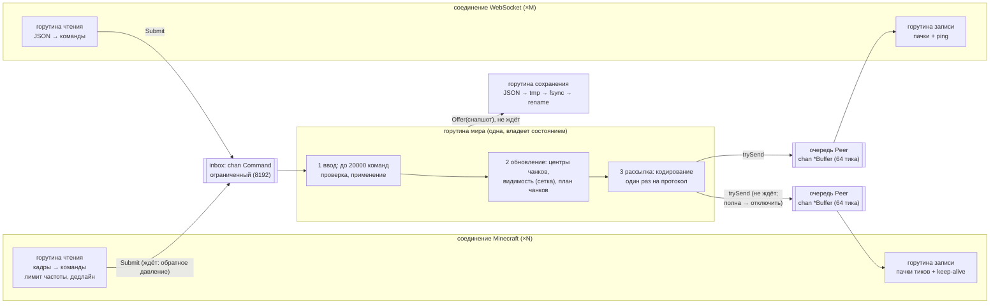

# Игровой сервер `gameserver`

Модуль 15 («Кейс: игровой сервер»). Учебный сервер, совместимый с
подмножеством протокола **Minecraft Java Edition 1.21 / 1.21.1 (протокол
767)**, и **WebSocket-шлюз** для браузерного клиента. Оба работают на
одном игровом цикле: игроки Minecraft и браузерные игроки находятся в одном
мире, видят друг друга и пишут в общий чат.

Сервер неофициальный и с Mojang не связан. Ресурсов Mojang в репозитории
нет: ни jar, ни ассетов, ни дампов реестров. Подключаться нужно своим
лицензионным клиентом 1.21.1.

Это витрина практик модуля, и последний урок модуля разбирает её код.
Уроки 01–12 показывают те же идеи в песочнице на упрощённом протоколе,
здесь они работают вместе.

## Быстрый старт

```sh
# из корня репозитория
docker-compose --profile labs up -d --build gameserver

# Minecraft 1.21.1: Мультиплеер → Добавить сервер → адрес localhost
# браузерный клиент: страница сайта учебника (ws://127.0.0.1:25580/ws)
curl -s 127.0.0.1:25590/metrics | grep '^gameserver_tps'

# нагрузочный прогон: 200 ботов, 60 с, отчёт с TPS и MSPT
docker-compose --profile labs run --rm gamebots
```

| Адрес (только 127.0.0.1) | Что |
|---|---|
| `127.0.0.1:25565` | Minecraft (TCP) |
| `ws://127.0.0.1:25580/ws` | WebSocket-шлюз браузерного клиента |
| `http://127.0.0.1:25590` | служебный порт: `/metrics`, `/healthz`, `/readyz`, `/debug/pprof/` |

Без Docker:

```sh
cd labs/gameserver
GAME_SAVE_PATH=/tmp/world.json go run ./cmd/gameserver
```

## Карта кода

```
labs/gameserver/
├── cmd/gameserver/main.go      окружение → app.Run, сигналы
├── cmd/bots/                   нагрузочные боты (Minecraft на mcproto + WebSocket) и отчёт
├── internal/
│   ├── app/                    сборка сервера (вся композиция — в Run), конфигурация GAME_*
│   ├── world/                  мир: игровой цикл, команды, проверка ввода, interest management
│   │   ├── loop.go             фиксированный тик 20 TPS, лимит догоняния, замер TPS
│   │   ├── world.go            фазы тика: ввод → обновление → рассылка; видимость; чанки; снапшот
│   │   ├── validate.go         скорость, NaN/Inf, границы, чат, дальность действий с блоками
│   │   ├── grid.go             пространственный хеш (ячейка = чанк)
│   │   ├── peer.go             ограниченная очередь исходящих пачек клиента, пул буферов
│   │   ├── command.go          входящие команды, Submit/Join (ограниченный канал)
│   │   ├── event.go            нейтральные события и интерфейс Protocol
│   │   └── blocks.go           плоский мир: генератор + правки, версии чанков
│   ├── mcproto/                VarInt, строки, позиции, кадры, сжатие zlib с лимитами, NBT-текст
│   ├── mc/                     Minecraft: handshake/status/login/configuration/play, кодировщик событий, чанки
│   ├── websocket/              свой минимальный RFC 6455 (сервер и клиент)
│   ├── gateway/                WebSocket-шлюз: JSON-протокол, кодировщик событий
│   ├── save/                   асинхронные атомарные снапшоты
│   ├── metrics/                Prometheus
│   ├── limit/                  token bucket для горутин чтения
│   └── e2e/                    сквозной тест: бот go-mc + браузерный клиент
└── Dockerfile                  цели gameserver и bots; scratch, не root
```

Автору урока «разбор сервера» удобно идти в таком порядке: `world/loop.go` →
`world/world.go` (функция `Step` и три фазы) → `world/peer.go` →
`mc/play.go` (горутины чтения и записи) → `mc/encoder.go` и `mc/chunk.go` →
`gateway/` → `app/app.go` (сборка и остановка).

## Архитектура



**Одна горутина владеет миром.** Игроки, блоки и зоны видимости живут в
горутине тика (`World.Run` → `Step`). Мьютексов вокруг состояния нет.
Соединения общаются с миром только сообщениями: команды идут в мир через
ограниченный канал `inbox`, изменения уходят из мира в очереди клиентов.

**Тик 50 мс, три фазы** (`world.Step`):

1. *Ввод.* Из `inbox` разбирается не больше `MaxCommandsPerTick` команд,
   остальные ждут следующего тика. Каждая команда проверяется
   (`validate.go`) и применяется. Результат — события в исходящую очередь
   тика.
2. *Обновление.* Игроки, сменившие чанк, переносятся в пространственном
   хеше, им выгружаются чанки вне квадрата видимости и строится план
   загрузки (ближние первыми). Затем для них пересчитывается видимость, и
   каждому игроку уходит порция чанков (`ChunksPerTick`).
3. *Рассылка.* События кодируются в байты протокола получателя. Широковещательное
   событие (перемещение, чат, вход) кодируется **один раз на протокол** и
   копируется в пачки всех получателей. Каждый клиент получает одну пачку
   за тик через неблокирующую отправку (`select … default`).

**Перегрузка.** Цикл идёт с фиксированным шагом и догоняет небольшое
отставание тиками подряд. Если отстал больше чем на 5 тиков (`maxCatchUp`),
долг списывается (`gameserver_ticks_skipped_total`): мир замедляется, а не
крутит десятки тиков подряд. Тик дольше 50 мс пишет в журнал
предупреждение `tick overran`, не чаще раза в 5 с.

**Обратное давление.** У двух направлений разное поведение, и это
сделано нарочно:

- Входящие команды. `Submit` ждёт места в канале. Горутина чтения
  останавливается, клиент упирается в TCP-окно. Команды не теряются, а
  память не растёт.
- Исходящие пачки. Тик никогда не ждёт. Если очередь клиента (64 тика,
  около 3 с) полна, клиент «медленный»: мир закрывает его `Peer` с причиной
  `slow_consumer` и убирает игрока в начале следующего тика. Это видно в
  журнале и в метрике `gameserver_disconnects_total{reason="slow_consumer"}`.
  Один медленный клиент не тормозит остальных.

**Interest management.** Зона видимости — квадрат `(2R+1)²` чанков вокруг
чанка игрока (`GAME_VIEW_DISTANCE`, по умолчанию R = 6). Отношение «видит»
симметрично: у всех один радиус. Поэтому видимость пересчитывается только
для тех, кто сменил чанк. Соседей ищет пространственный хеш (`grid.go`,
ячейка = чанк): это обход `(2R+1)²` ячеек вместо перебора всех игроков.
Кому что отправлять:

| Событие | Получатели |
|---|---|
| перемещение / поворот | те, кто видит игрока (кроме тех, кто увидел его в этом тике: им ушло появление с актуальной позицией) |
| появление / исчезновение | при входе / выходе из квадрата, парами в обе стороны |
| чат игрока | автор и те, кто его видит |
| вход / выход (список игроков, системные сообщения) | все |
| изменение блока | те, у кого загружен этот чанк |
| чанки | свои каждому, по плану, `ChunksPerTick` за тик |

Отправляются только изменения: дельты перемещения (в Minecraft — Update
Entity Position в 1/4096 блока, дальше 8 блоков — телепорт), а не полное
состояние мира.

**Производительность.** В установившемся режиме тик не аллоцирует.
`TestStepAllocsSteadyState` проверяет тик с 20 игроками без событий,
`BenchmarkTick200` (ниже) — тик, где все 200 игроков двигаются,
`TestEncodeAllocs` — кодирование пакета, `TestHotPathNoAllocs` — метрики
тика. Для этого:

- кодирование в стиле append в переиспользуемые буферы, одна пачка из
  `sync.Pool` на клиента за тик;
- исходящая очередь событий тика переиспользуется между тиками;
- серии метрик с метками (причины отключений и отказов, протоколы)
  получены заранее, на событие — поиск в карте и атомарный инкремент.

Бенчмарк худшего случая: 200 Minecraft-игроков в одной зоне видимости,
все двигаются, каждое перемещение уходит 199 зрителям (около 40 000
пакетов за тик):

```sh
go test -run='^$' -bench=Tick200 -benchmem ./internal/mc
# BenchmarkTick200-12   2776   423563 ns/op   5472 B/op   0 allocs/op   (Apple M4 Pro)
```

То есть 0.4 мс из бюджета 50 мс и ноль аллокаций на тик (байты на операцию —
амортизированный рост переиспользуемых буферов).

Плоский мир почти весь одинаковый, поэтому базовые секции, карта высот и
свет кодируются один раз при старте. Готовые сжатые пакеты чанков
кешируются по `(позиция, версия)` (`gameserver_chunk_cache_*`). Сжатие
zlib включено с порогом 256 байт: чанк со светом сжимается с ~60 КБ до
~1 КБ.

## Протокол Minecraft

Кадрирование, состояния соединения и разбор пакетов написаны здесь
(`mcproto`, `mc`). Из [go-mc](https://github.com/Tnze/go-mc) (MIT, псевдоверсия
`v1.20.3-0.20241224032005-539b4a3a7f03`) взято то, что писать руками
бессмысленно:

- номера пакетов (`data/packetid`);
- таблица состояний блоков 1.21.1 (`level/block`);
- реестр типов сущностей (`data/registryid`);
- в тестах — бот (`bot`) и парсер чанков (`level`).

Номера пакетов сверяет с таблицей протокола 767 тест `TestPacketIDs`.
Фреймворк `go-mc/server` (он на протоколе 764) не используется.

**Поддержано:**

- handshake; пинг списка серверов: версия `1.21.1`/767, онлайн и максимум,
  описание «go-tutor labs — учебный сервер (неофициальный)», ping/pong;
- вход в offline-режиме: UUID v3 от `OfflinePlayer:<имя>`, как у
  ванильного сервера, имя 3–16 символов `[A-Za-z0-9_]`; клиент другой
  версии получает отказ с текстом;
- сжатие (Set Compression, порог 256) в обе стороны. Входящий кадр не
  длиннее 32 КиБ (до входа — 1–4 КиБ), распакованный размер не больше
  предела, заявленная длина обязана совпасть с фактической;
- configuration с **known packs**: сервер предлагает `minecraft:core`
  версий `1.21.1` и `1.21` и шлёт реестры только именами записей, без NBT
  (клиент берёт содержимое из своих ванильных данных). Клиент без
  ванильных данных получает отказ;
- play:
  - Login, способности (креатив: полёт, мгновенная ломка), граница мира,
    вечный полдень, точка появления;
  - Synchronize Player Position с подтверждением телепорта;
  - Game Event 13 «start waiting for level chunks» — без него клиент 1.20.3+
    висит на «Загрузка ландшафта»;
  - Set Center Chunk, пачки чанков (Chunk Batch Start/Finished), чанки со
    светом (небесный свет 15 везде), выгрузка;
  - keep-alive раз в 10 с (следующий — только после ответа на прошлый).
    Проверка — тем же таймером, поэтому без ответа клиент отключается
    через 30–40 с (`timeout`);
  - перемещение и поворот;
  - чат: сообщения игроков рассылаются как system chat «<имя> текст», без
    подписей (offline), системные — жёлтым;
  - другие игроки: Player Info Update / Remove, Spawn Entity (тип
    `minecraft:player`), перемещения, поворот головы, Remove Entities;
  - ломать (креатив) и ставить блоки: блок — из предмета в руке, Block
    Update и Acknowledge Block Change для предсказания клиента.

**Не поддержано:** шифрование и online-режим (проверка аккаунтов Mojang),
скины (свойства профиля пустые — у всех скины по умолчанию), команды (`/…`
игнорируются), инвентарь и предметы, кроме выбора блока для постройки,
сущности, кроме игроков, физика и столкновения на сервере, вода, свет от
блоков, метаданные сущностей (присед и т. п.), Update Tags (теги реестров —
поведение клиента, завязанное на теги, например лазание по лестницам или
вода, не работает), другие измерения,
transfer.

**Offline-режим и почему только локально.** Без шифрования и проверки
сессии сервер верит имени, которое прислал клиент. Любой может войти под
любым ником, а сохранения привязаны к нику. Для учебного стенда на своей
машине это нормально, в сети — нет. Поэтому порты опубликованы только на
`127.0.0.1`, а в сеть песочницы сервер не входит.

## Протокол WebSocket

Спецификация для автора браузерного клиента (страница сайта учебника).

**Почему JSON.** Его видно в DevTools (Network → WS), а разбор в браузере —
одна строка `JSON.parse`. Трафик браузерного клиента невелик: одна вкладка,
дальность 6 чанков. Чанки кешируются и уходят один раз. Бинарный формат
сэкономил бы байты, но усложнил бы отладку, ради которой этот клиент и
существует как визуализатор.

**Почему своя реализация RFC 6455, а не библиотека.** Стандартная
библиотека WebSocket не умеет. `github.com/coder/websocket` — хороший
выбор для продакшна. Шлюзу же нужно малое подмножество: текстовые
сообщения, ping/pong, close, лимит размера, без расширений и
подпротоколов. Своя реализация — около 470 строк (`websocket.go` и
`handshake.go`), которые разбирает урок.
Она покрыта тестами (фрагментация, управляющие кадры между фрагментами,
нарушения протокола с правильными кодами закрытия, UTF-8, маскирование)
и fuzz-тестом `FuzzReadMessage`. Расширение permessage-deflate не
поддерживается: сжатие в WebSocket — отдельный класс атак, а браузер без
него работает.

### Подключение

- URL: `ws://127.0.0.1:25580/ws` (или `ws://localhost:25580/ws`).
- `Origin` страницы должен быть в `GAME_WS_ORIGINS`. По умолчанию это
  `http://localhost:8080`, `http://127.0.0.1:8080` (сайт в Docker) и
  `http://localhost:4321`, `http://127.0.0.1:4321` (dev-сервер Astro).
  Иначе рукопожатие получает 403.
- Все сообщения — текстовые кадры с JSON. Клиент → сервер — один объект на
  сообщение. Сервер → клиент — **массив событий одного тика**, последним
  всегда идёт `tick`. Обрабатывать так: `for (const ev of JSON.parse(e.data))`.
- Координаты — блоки (float, 3 знака). Ось `y` вверх, мир — квадрат
  `[-borderRadius, borderRadius]` по `x` и `z`. Земля — `y = groundY` (−61),
  игрок стоит на `y = −60`. Углы — градусы: `yaw` 0 = +Z (юг), 90 = −X
  (запад), как в Minecraft; `pitch` от −90 (вверх) до 90 (вниз).
- Чанк — 16×16 блоков. Чанк блока: `cx = Math.floor(x / 16)`,
  `cz = Math.floor(z / 16)`.

### Клиент → сервер

| Сообщение | Когда | Поля |
|---|---|---|
| `{"t":"hello","name":"Alice"}` | первым, не позже 5 с после подключения | `name` — 3–16 символов `[A-Za-z0-9_]` (то же правило, что у Minecraft) |
| `{"t":"tpack","tp":1}` | сразу после `welcome` и каждого `teleport` | `tp` — номер из этих событий. **Пока нет подтверждения, перемещения игнорируются** |
| `{"t":"move","x":1.5,"z":-3.2,"yaw":90}` | при движении, не чаще 20 раз в секунду (раз в тик) | `x`, `z` — обязательны; `y` (по умолчанию −60), `yaw`, `pitch` — необязательны |
| `{"t":"chat","text":"привет"}` | | до 256 символов, без управляющих символов и `§`; пробелы по краям обрезаются |
| `{"t":"dig","x":3,"y":-61,"z":5}` | сломать блок | целые координаты блока |
| `{"t":"place","x":3,"y":-60,"z":5,"block":"minecraft:stone"}` | поставить блок | `block` — из списка `placeable` в `welcome`; клетка должна быть пустой |

**Позиция входа.** Позиция в `welcome` — это сохранённая позиция игрока с
этим ником (если он уже заходил) или `world.spawn` со случайным разбросом
до ±8 блоков по `x` и `z`, чтобы вошедшие подряд не стояли в одной точке.
Поэтому она обычно не совпадает с `world.spawn`.

**Подтверждение телепорта.** Если `tpack` на `welcome` или `teleport` не
пришёл за 2 с, сервер повторяет ту же позицию с тем же `tp` событием
`teleport` с `reason: "resend"` — и так каждые 2 с, пока не получит
подтверждение. Перемещения до подтверждения игнорируются.

**Чат не хранится.** Сервер рассылает сообщение только тем, кто онлайн
и видит автора в момент отправки. Вошедший позже старых сообщений не
получит; история — забота клиента.

Неизвестные типы `t` сервер пропускает. Это позволяет клиенту быть новее
сервера. Сообщение с невалидным JSON или без обязательных полей
заканчивается `kick` и закрытием соединения.

### Сервер → клиент

Каждое сообщение — массив, например:

```json
[{"t":"move","id":5,"x":12.345,"y":-60,"z":-3.2,"yaw":90,"pitch":0},
 {"t":"tick","n":10234,"mspt":0.84,"tps":20,"msgs":1,"bytes":67}]
```

| `t` | Поля | Смысл |
|---|---|---|
| `welcome` | `id`, `name`, `uuid`, `x`, `y`, `z`, `yaw`, `pitch`, `tp`, `viewDistance`, `tickRate`, `maxPlayers`, `maxChat`, `world: {chunkSize, minY, height, groundY, borderRadius, spawn: {x,y,z}}`, `placeable: [имена блоков]` | первое событие после входа. Ответить `tpack` с `tp` |
| `join` | `id`, `name`, `uuid`, `kind` (`"minecraft"` / `"web"`) | игрок вошёл на сервер (список игроков). Сразу после `welcome` приходит `join` для каждого игрока онлайн, включая себя |
| `leave` | `id`, `name` | игрок вышел с сервера |
| `spawn` | `id`, `name`, `kind`, `x`, `y`, `z`, `yaw`, `pitch` | сущность игрока вошла в зону видимости — начать рисовать |
| `despawn` | `id` | вышла из зоны видимости (или игрок ушёл) — перестать рисовать |
| `move` | `id`, `x`, `y`, `z`, `yaw`, `pitch` | новая позиция видимого игрока (абсолютная). Своего перемещения клиент не получает |
| `chat` | `id`, `name`, `text` | сообщение игрока: своё и тех, кого видишь |
| `system` | `text` | системное сообщение (вход/выход, отказ в чате) |
| `center` | `x`, `z` | новый центр зоны видимости (чанк игрока). Зона — чанки от `x−viewDistance` до `x+viewDistance` |
| `chunk` | `x`, `z`, `palette: [имена]`, `top: [256]`, `height: [256]` | чанк загружен. Для колонки `(lx, lz)` (0..15) индекс `i = lz*16 + lx`: верхний непустой блок — `palette[top[i]]`, его высота — `height[i]` |
| `unchunk` | `x`, `z` | чанк выгружен (вышел из зоны) — забыть |
| `block` | `x`, `y`, `z`, `block`, `topY`, `top` | блок изменился. `top`/`topY` — новый верх колонки `(x, z)` для карты сверху. Приходит и в ответ на отклонённое действие (с настоящим состоянием) |
| `teleport` | `tp`, `x`, `y`, `z`, `yaw`, `pitch`, `reason` | сервер поправил позицию (`too_fast`, `out_of_bounds`, `resend`). Поставить игрока сюда и ответить `tpack` |
| `kick` | `reason` | последнее сообщение, дальше close (1008 — нарушение, 1001 — остановка сервера) |
| `tick` | `n`, `mspt`, `tps`, `msgs`, `bytes` | последний в каждом массиве тика (исключение — ниже). `n` — номер тика, `mspt` — длительность прошлого тика (мс), `tps` — фактическая частота, `msgs` — сколько событий ушло **этому клиенту** в этом тике, `bytes` — размер этих событий в байтах JSON (каждое вместе с запятой после него, без `[` и без самого `tick`; в примере выше — 67 байт одного `move`). Сам `tick` в `msgs` и `bytes` не входит: пачка только из `tick` даёт `msgs: 0, bytes: 0`. Для визуализатора |

Порядок внутри массива — порядок событий в тике. Сначала события ввода и
обновления (вход, появления, чат, блоки, чанки), потом перемещения, в конце
`tick`. Пачка приходит каждый тик, даже если в ней только `tick`: по ним
визуализатор рисует график MSPT/TPS.

**Исключение: `kick` вне тика.** Отказ до входа в мир (плохой `hello`,
недопустимое имя, сервер полон, имя занято) и нарушения протокола
(невалидный JSON, нет обязательных полей, флуд) приходят отдельным
сообщением `[{"t":"kick","reason":…}]` без `tick`, затем close. `kick` от
мира (остановка сервера, NaN в координатах) приходит обычной пачкой с
`tick`.

### Типичный сценарий клиента

```js
const ws = new WebSocket("ws://127.0.0.1:25580/ws");
ws.onopen = () => ws.send(JSON.stringify({ t: "hello", name: "Alice" }));
ws.onmessage = (e) => {
  for (const ev of JSON.parse(e.data)) {
    switch (ev.t) {
      case "welcome": case "teleport":
        me = ev; ws.send(JSON.stringify({ t: "tpack", tp: ev.tp })); break;
      case "chunk":   chunks.set(`${ev.x},${ev.z}`, ev); break;
      case "unchunk": chunks.delete(`${ev.x},${ev.z}`); break;
      case "spawn":   entities.set(ev.id, ev); break;
      case "move":    Object.assign(entities.get(ev.id), ev); break;
      case "despawn": entities.delete(ev.id); break;
      case "tick":    stats.push(ev); break;
    }
  }
};
// движение — не чаще раза в 50 мс, со скоростью до 30 блоков/с (ходьба — 4.3)
```

### Лимиты шлюза

| Что | Значение |
|---|---|
| размер входящего сообщения | 4 КиБ (больше — close 1009) |
| частота входящих сообщений | 40/с, запас 80 (больше — `kick` «too many messages») |
| частота кадров (включая ping/pong и фрагменты) | 80/с, запас 160 (больше — close 1008 без `kick`) |
| первое сообщение `hello` | 5 с с момента подключения, абсолютный дедлайн (ping и фрагменты его не продлевают) |
| запись кадра сервером (в том числе pong и close) | 10 с: клиент, который шлёт ping и не читает ответы, отключается |
| тишина от клиента | 45 с (сервер шлёт ping каждые 15 с, браузер отвечает сам) |
| соединений одновременно | 256 (`GAME_WS_MAX_CONNS`) |
| очередь исходящих | 64 тика (клиент не читает 3 с — отключение `slow_consumer`) |

Браузерный игрок проходит ту же проверку и те же лимиты мира, что
Minecraft-игрок (см. ниже).

## Безопасность и лимиты

Всё, что приходит от клиента, — враждебный ввод.

| Где | Защита |
|---|---|
| TCP / WebSocket | лимит соединений (`GAME_MAX_CONNS` 512, `GAME_WS_MAX_CONNS` 256). Дедлайн на весь вход в Minecraft 10 с, до входа — не больше 128 пакетов; на `hello` — 5 с (абсолютный). Дедлайны чтения (30/45 с) и записи (10 с, в том числе pong/close), keep-alive / ping. HTTP-серверы шлюза и служебного порта: `ReadHeaderTimeout` 5 с, `IdleTimeout` 30 с. Временные ошибки `Accept` (например, EMFILE) не останавливают сервер: пауза 5 мс → 1 с с удвоением. Лимита попыток входа с одного адреса нет — стенд слушает только 127.0.0.1 |
| кадры Minecraft | длина ≤ 32 КиБ (до входа — 1–4 КиБ), VarInt длины ≤ 3 байт. Распакованный размер ≤ предела и равен заявленному (защита от zip-бомбы). Строки — с лимитом символов и проверкой UTF-8. Лишние байты в пакете фиксированного формата — ошибка `bad_packet` (у чата и слота креатива хвост переменный и пропускается) |
| частота | Minecraft — 100 пакетов/с, запас 300; WebSocket — 40 сообщений/с. Превышение — отключение `rate_limit` |
| перемещение | NaN/Inf — kick с причиной и отключение `bad_input`. За границей мира — поправка. Скорость — «бюджет пути»: пополняется на `MaxSpeed/20` блока за тик и копится не больше чем на 1 с. Превышение — телепорт назад (`too_fast`), перемещения игнорируются до подтверждения |
| чат | ≤ 256 символов, валидный UTF-8, без управляющих символов, `§`, U+2028/2029. Не чаще 1/с, запас 5 |
| блоки | дальность ≤ 6 блоков от глаз, чанк загружен у игрока, в границах мира и по высоте; бедрок (пол мира) не ломается. Не чаще 10/с. Браузер ставит только блоки из `placeable`. Всего в мире не больше `GAME_MAX_BLOCK_EDITS` (100 000) правок — дальше отказ `block_limit` и системное сообщение «World edit limit reached»; вернуть блок как было можно всегда |
| WebSocket-кадры | close от клиента с недопустимым кодом (1005, 1006, 1015, <1000, 1016–2999) — ответ 1002; причина не UTF-8 — 1007 |
| игроки | `GAME_MAX_PLAYERS` (256). Второй вход с тем же ником — отказ |
| WebSocket | проверка `Origin` по списку `GAME_WS_ORIGINS`. Клиенты без `Origin` (боты, тесты) пропускаются: подделать заголовок они могут и так, а `Origin` защищает от чужих страниц в браузере пользователя |
| fuzz | `FuzzFrameReader`, `FuzzDecoder` (mcproto), `FuzzDecodePlay` (mc), `FuzzReadMessage` (websocket), `FuzzAppendString` (gateway) |
| образ | scratch, uid 65532, `read_only`, порты только на 127.0.0.1, не в сети `sandbox`; pprof — только на служебном порту |

## Переменные окружения

| Переменная | По умолчанию | Что |
|---|---|---|
| `GAME_MC_ADDR` | `:25565` | адрес Minecraft |
| `GAME_WS_ADDR` | `:25580` | адрес WebSocket-шлюза |
| `GAME_OPS_ADDR` | `:25590` | служебный HTTP |
| `GAME_WS_ORIGINS` | `http://localhost:8080,http://127.0.0.1:8080,http://localhost:4321,http://127.0.0.1:4321` | разрешённые `Origin`, через запятую |
| `GAME_SAVE_PATH` | — (не сохранять) | файл снапшота мира; в compose — `/data/world.json` |
| `GAME_SAVE_INTERVAL` | `30s` | период фонового снапшота |
| `GAME_MAX_PLAYERS` | `256` | игроков онлайн |
| `GAME_MAX_CONNS` / `GAME_WS_MAX_CONNS` | `512` / `256` | соединений одновременно |
| `GAME_VIEW_DISTANCE` | `6` | радиус зоны видимости, чанков (2–16) |
| `GAME_CHUNKS_PER_TICK` | `8` | чанков игроку за тик |
| `GAME_BORDER_RADIUS` | `512` | полуширина мира, блоков |
| `GAME_MAX_SPEED` | `30` | предел скорости, блоков/с |
| `GAME_COMPRESSION_THRESHOLD` | `256` | порог сжатия Minecraft, байт (`-1` — без сжатия) |
| `GAME_QUEUE_LEN` | `64` | очередь исходящих, тиков |
| `GAME_MAX_BLOCK_EDITS` | `100000` | предел правок блоков во всём мире (`0` — без предела) |
| `GAME_MOTD` | «go-tutor labs — учебный сервер (неофициальный)» | описание в списке серверов |
| `GAME_LOG_LEVEL` | `info` | `debug`, `info`, `warn`, `error` |
| `GAME_PPROF` | `true` | `/debug/pprof/` на служебном порту |
| `GOMEMLIMIT` | в compose `400MiB` при `mem_limit: 512m` | мягкий предел кучи для GC |

## Метрики

`http://127.0.0.1:25590/metrics` (Prometheus профиля labs собирает их как
job `gameserver`):

| Метрика | Что |
|---|---|
| `gameserver_tick_duration_seconds` (гистограмма) | MSPT — длительность тика. `histogram_quantile(0.99, rate(gameserver_tick_duration_seconds_bucket[1m]))` |
| `gameserver_tick_duration_max_seconds` | максимум за последние 5 с — пики, которые сглаживает гистограмма |
| `gameserver_tps` | фактическая частота по последним 20 тикам (цель 20) |
| `gameserver_ticks_total`, `gameserver_ticks_skipped_total` | тики и списанные при перегрузке |
| `gameserver_players{kind}` | игроки онлайн: `minecraft`, `web` |
| `gameserver_connections{proto}` | открытые соединения |
| `gameserver_disconnects_total{reason}` | отключения: `quit`, `timeout`, `slow_consumer`, `rate_limit`, `bad_packet`, `bad_input`, `shutdown` |
| `gameserver_rejected_input_total{reason}` | отклонённый ввод: `too_fast`, `out_of_bounds`, `not_finite`, `chat_rate`, `chat_invalid`, `block_rate`, `block_reach`, `block_state` |
| `gameserver_join_rejected_total`, `gameserver_connections_rejected_total` | отказы во входе (сервер полон, имя занято, версия, лимит соединений, Origin) |
| `gameserver_bytes_out_total{proto}`, `gameserver_packets_in_total{proto}` | трафик |
| `gameserver_chunks_sent_total`, `gameserver_chunk_cache_hits_total`, `…_misses_total` | чанки и кеш их пакетов |
| `gameserver_inbox_length` | очередь команд в начале тика: растёт — мир не успевает разбирать ввод |
| `gameserver_snapshots_total{result}`, `gameserver_snapshot_duration_seconds` | сохранения: `ok`, `skipped`, `error` |
| `go_*`, `process_*` | рантайм Go: GC, горутины, память |

Профили — `go tool pprof http://127.0.0.1:25590/debug/pprof/profile?seconds=20`
во время нагрузочного прогона.

## Сохранения и остановка

- Каждые `GAME_SAVE_INTERVAL` тик делает копию сохраняемого состояния
  (`World.Snapshot`): правки блоков относительно генератора и позиции
  игроков по нику. Копию он отдаёт горутине сохранения неблокирующим
  `Offer`. Если прошлый снапшот ещё не записан (`Store.Busy`), тик не
  делает копию вовсе, и этот снапшот пропускается (`skipped`); очереди
  снапшотов нет, тик диск не ждёт. В тике — только копирование (O(правок),
  их число ограничено `GAME_MAX_BLOCK_EDITS`); сортировку для стабильного
  файла (`Snapshot.Sort`) делает горутина сохранения.
- Запись атомарна: временный файл в том же каталоге, `fsync`, `rename`
  поверх старого, `fsync` каталога. Если процесс упадёт посреди записи, на
  диске останется прошлый целый снапшот. Битый файл при старте — ошибка, а
  не пустой мир.
- В compose файл лежит в томе `gameserver-data` (`/data/world.json`) и
  переживает пересоздание контейнера. Сбросить мир:
  `docker-compose rm -sf gameserver && docker volume rm go-tutor_gameserver-data`.
- **Graceful shutdown** (`SIGTERM` от `docker stop`): `/readyz` отвечает
  503, слушатели закрываются. Мир досчитывает тик, каждому игроку уходит
  kick «Server is shutting down», мир отдаёт финальный снапшот.
  Соединения, не дошедшие до игры (handshake, login, configuration, WebSocket
  без `hello`), закрываются сразу по отмене контекста. Игрокам Minecraft и
  браузера даётся до 5 с (общий бюджет, дренаж параллельно) дописать kick,
  затем снапшот пишется на диск синхронно. Слушатели закрываются до
  ожидания соединений, чтобы `WaitGroup.Add` не гонялся с `Wait`. `stop_grace_period: 30s` — с большим запасом: на стенде
  остановка занимает миллисекунды. `TestShutdownWithStuckHandshakes`
  проверяет, что застрявшие входы не задерживают остановку. Сохранение проверяет `TestGracefulShutdownSaves`
  (`internal/app`): после перезапуска блок на месте, а игрок появляется
  там, где вышел.

## Нагрузочный прогон

```sh
docker-compose --profile labs up -d --build gameserver
docker-compose --profile labs run --rm gamebots                     # 200 ботов, 60 с
docker-compose --profile labs run --rm gamebots -n 250 -duration 2m # свои параметры
```

Боты (`cmd/bots`) — свои клиенты. Minecraft-боты (по умолчанию 75%)
написаны на `mcproto`: вход, configuration, ответы на keep-alive и
телепорты; сжатые пакеты (чанки) они не распаковывают, чтобы не делить CPU
ноутбука с сервером. Остальные боты — WebSocket. Каждый бот ходит со
скоростью 4.3 блока/с к случайным точкам в квадрате ±160 блоков
(`-spread`), шлёт позицию каждый тик и примерно раз в 20 с пишет в чат.
Прогон: подключение за `-ramp` (10 с) → 3 с на загрузку чанков → замер
`-duration`. Каждую секунду боты снимают `/metrics` сервера.

**Критерий этапа: 200 игроков, 20 TPS.** Результат на ноутбуке разработки
(Apple Silicon, Docker Desktop, 60 с):

```
=== gameserver load report: 200 bots, 1m0s ===
players online      min 200
TPS                 avg 20.00  min 19.97   (target 20)
ticks               1200 (20.0/s), skipped 0
MSPT                p50 1.47 ms  p99 5.63 ms  max 23.61 ms   (budget 50 ms)
traffic out         11.80 MB/s
bots                joined 200, failed to join 0, dropped 0, moves 3995/s, packets in 299024/s, chat recv 965/s
server corrections  0 teleports to bots, 0 rejected inputs
server disconnects  none
verdict             PASS: the server holds 20 TPS
```

Запас: без Docker на той же машине 600 ботов дают p99 MSPT 8.8 мс при
20 TPS (`GAME_MAX_PLAYERS=1000`).

**Как читать отчёт:**

- `TPS avg/min`. Средняя и минимальная частота по ежесекундным снятиям
  `gameserver_tps`. Ниже 20 — тик не укладывается в 50 мс, или цикл
  списывает долг (`skipped > 0`).
- `MSPT p50/p99`. Квантили по приросту гистограммы
  `gameserver_tick_duration_seconds` за время замера (линейная
  интерполяция внутри корзины, как `histogram_quantile`). `max` — максимум
  `gameserver_tick_duration_max_seconds`. Единичный пик до 20–30 мс —
  обычно пауза машины или GC, он не опасен, пока p99 далеко от 50 мс.
- `traffic out`. Основной расход: перемещения 200 игроков, каждое уходит
  всем, кто видит. Это квадратичная часть нагрузки. Если собрать ботов
  плотнее (`-spread 30`), трафик и MSPT вырастут, если разнести
  (`-spread 400`) — упадут. Так interest management виден в цифрах.
- `bots dropped`, `server disconnects`. В здоровом прогоне — 0 и `none`.
  `slow_consumer` означает, что машина не успевает вычитывать трафик ботов.
- `server corrections`. Поправки позиции ботам. Боты ходят медленнее
  предела, поэтому должно быть 0.
- Код выхода: 0 — PASS, 2 — FAIL. Критерий: TPS avg ≥ 19.5, min ≥ 18.5,
  p99 < 50 мс, нет списанных тиков, все боты вошли и не отвалились.

## Тесты

```sh
cd labs/gameserver
go vet ./... && go test -race ./...
# fuzz, коротко
go test -run=^$ -fuzz=FuzzFrameReader -fuzztime=30s ./internal/mcproto
go test -run=^$ -fuzz=FuzzDecodePlay  -fuzztime=30s ./internal/mc
go test -run=^$ -fuzz=FuzzReadMessage -fuzztime=30s ./internal/websocket
# сквозной тест против контейнера (бот go-mc + браузерный клиент)
GAME_E2E_MC=127.0.0.1:25565 GAME_E2E_WS=127.0.0.1:25580 go test -count=1 -v ./internal/e2e/
```

- `internal/world`: детерминированная симуляция. Тики вызываются вручную
  (`Step`), часы фейковые, клиенты записывают события строками — без
  сокетов и sleep. Проверяются:
  - порядок входа (`welcome` первым);
  - взаимное появление и исчезновение при уходе из зоны;
  - поправка скорости, NaN, чат по видимости и лимиты, медленный клиент;
  - блоки, снапшот и восстановление, позиция при повторном входе, остановка;
  - свойство видимости на случайных блужданиях: клиент, собирающий картину
    только из `spawn`/`despawn`, в каждом тике видит ровно тех, кто в
    радиусе;
  - тик без аллокаций.
- `internal/mcproto`: VarInt (примеры из описания протокола), позиции,
  лимиты строк, UUID offline-игрока (`Notch` → `b50ad385-…`), кадры со
  сжатием и без, zip-бомба.
- `internal/mc`: номера пакетов против таблицы 767; чанк с правками
  (своя и прямая палитры) разбирается парсером go-mc; выбор пакета
  перемещения; разбор установки блока. Интеграция на loopback: порядок
  пакетов входа, отказ по версии и имени, клиент без ванильных данных,
  флуд пакетами, кадр больше предела.
- `internal/websocket`, `internal/gateway`: протокол, Origin, JSON,
  сценарий браузерного игрока, флуд.
- `internal/e2e`: **главная автоматическая проверка совместимости**.
  - Бот `go-mc/bot` (протокол 767) делает пинг списка, входит, получает
    join game и чанки; чанки разбирает парсер go-mc с проверкой блоков.
  - Второй бот и браузерный игрок видят друг друга (сущность и список
    игроков).
  - Работает чат в обе стороны, перемещения видны, выход убирает сущность.
  - По умолчанию сервер поднимается в процессе, с `GAME_E2E_*` — тот же тест
    идёт против контейнера.

## Ручная проверка с настоящим клиентом

Бот go-mc не рендерит мир и не проверяет данные реестров. Он не знает,
например, понравится ли клиенту список `damage_type` или свет в чанках.
Поэтому после изменений протокола нужна ручная проверка лицензионным
клиентом **Minecraft Java 1.21.1** (или 1.21):

1. `docker-compose --profile labs up -d --build gameserver site` — сервер и
   сайт с браузерным клиентом. Готовность: `curl -s 127.0.0.1:25590/readyz`.
2. Мультиплеер → «Добавить сервер» → адрес `localhost`. В списке видно
   описание «go-tutor labs — учебный сервер (неофициальный)», `0/256`, пинг.
3. Вход. Нет ошибки реестров («Failed to load registries…», «Missing key
   in minecraft:damage_type»), экран «Загрузка ландшафта» закрывается за
   секунды. Режим креатив, полдень.
4. Плоский мир: трава, по границам чанков — линии камня (их видно и на
   F3 + G). Освещение нормальное, не чёрное.
5. Летать (двойной пробел) и уйти на 100+ блоков: чанки догружаются
   впереди и выгружаются позади, граница мира — на ±512.
6. Второй клиент (или `go test ./internal/e2e/` с `GAME_E2E_*`, или
   браузерный клиент http://127.0.0.1:8080/game/ под другим ником): другой
   игрок виден со скином по умолчанию и ником, есть в Tab, двигается плавно,
   поворачивает голову. Уйти дальше 6 чанков — пропадает, вернуться —
   появляется.
7. Чат: сообщение видно у второго игрока и в браузере как «<ник> текст»;
   сообщения браузерного игрока видны в клиенте. Вход и выход — жёлтые
   системные сообщения.
8. Сломать блок (ЛКМ) и поставить блок из инвентаря (ПКМ) — изменение
   видно у второго игрока и на карте браузера. Бедрок на y=−64 не ломается.
9. Выйти и войти снова — появляетесь там, где вышли. `docker-compose
   restart gameserver` — постройки на месте.
10. Метрики при двух игроках (клиент и браузер):
    `curl -s 127.0.0.1:25590/metrics | grep gameserver_players` — `minecraft` 1
    и `web` 1; `gameserver_tps` держится около 20. После выхода игрок
    пропадает из Tab и с карты у второго игрока.
11. Остановка сервера (`docker-compose stop gameserver`) — в клиенте экран
    отключения «Server is shutting down».

Чего не ждать: сервер не шлёт Update Tags, поэтому поведение, завязанное на
теги, не работает — по лестницам и лианам не залезть, вода (если её
поставить) ведёт себя как воздух. Это не ошибка входа.

Если шаг не прошёл, запишите номер шага, что видно в клиенте (текст ошибки
или снимок экрана), и сохраните `docker-compose logs gameserver --tail 50`.

Если клиент отказывается входить с ошибкой про реестр, сверьте списки в
`internal/mc/registries.go` с ванильными для 1.21.1
(misode/mcmeta, ветка `1.21.1-registries`).

## Ограничения

- Мир плоский и конечный (±512 блоков), только верхний мир. Генератор и
  правки хранятся в памяти: правки — только отличия от генератора, не
  больше `GAME_MAX_BLOCK_EDITS`.
- Входящий пакет Minecraft в игре — не больше 32 КиБ. Set Creative Mode
  Slot с очень крупным предметом (книга, предмет с большим NBT) получит
  отключение `bad_packet`.
- Update Tags не отправляется: поведение клиента, завязанное на теги
  реестров, не работает (лазание по лестницам, вода и т. п.).
- Физики на сервере нет. Проверка перемещения — по скорости и границам, а
  не по столкновениям: через блоки пройти можно (в креативе клиент это и
  так позволяет).
- Карта высот в пакете чанка — от генератора, правки её не меняют (клиент
  пересчитывает её сам при изменении блоков).
- Изменение блока рассылается перебором игроков (O(N) на изменение, при
  лимите 10/с на игрока). Для больших серверов нужен обратный индекс «чанк →
  кто загрузил».
- Снапшот копирует все правки (O(правок)). Для большого мира понадобились бы
  грязные чанки и copy-on-write.
- Ник при offline-режиме — это и есть личность (см. выше).
